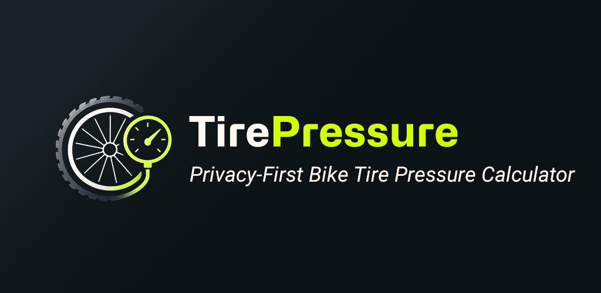
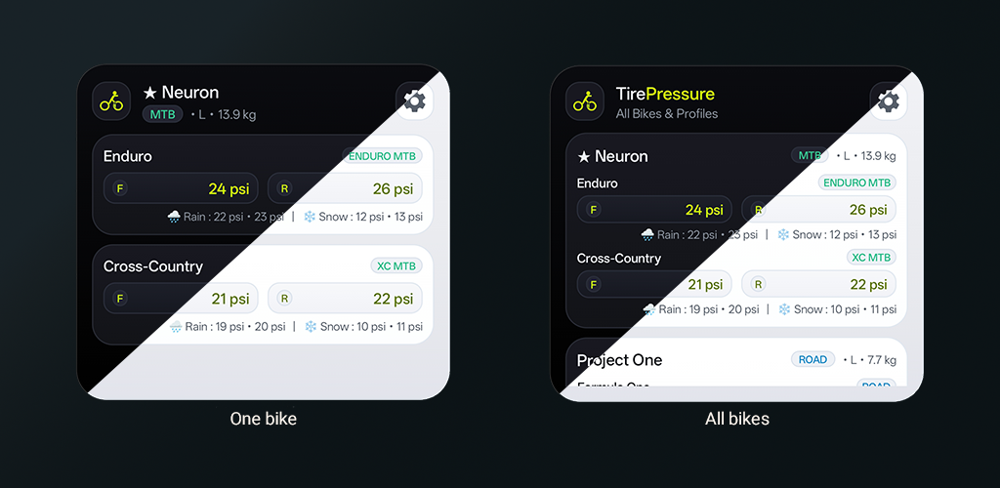

<p align="center">
  
</p>

<p align="center">
  <strong>The Ultimate Native Android Tire Pressure Companion for Road, Gravel, MTB and Commute bikes.</strong>
</p>

<p align="center">
  <a href="LICENSE"></a>
  
  
  
  
  
  
</p>

## 🤖 AI-Assisted Development

> [!NOTE]
> This application was designed, engineered, and tested with **AI-assisted coding** using Google DeepMind's **Antigravity** Advanced Agentic Coding environment. The entire development workflow—including implementation and validation of the open-source Frank Berto 15% Tire Drop physics model, Clean Architecture design, Jetpack Compose Material 3 UI/UX, native OxygenOS/ColorOS 16 & 17 style Home Screen widgets, full offline sandbox security, and 100% unit test coverage—was executed through human-AI collaborative pair programming.

## 🚴‍♂️ What TirePressure Solves: The End-User Experience

Every cyclist knows the feeling: you are gearing up for a ride, pumping your tires in the garage, and guessing what pressure to put in. 
- **Too high:** You bounce across chip-seal roads, sacrifice precious cornering grip, fatigue your upper body over gravel washboards, and risk blowing off hookless tubeless rims.
- **Too low:** You risk catastrophic rim strikes, pinch flats, tire squirm through fast berms, and sluggish rolling resistance on smooth tarmac.

**TirePressure** eliminates guesswork in seconds before you head out the door. It delivers laboratory-grade tire pressure recommendations based on **Frank Berto's renowned 15% Tire Drop physics model** combined with modern bicycle impedance and ETRTO standards, packaged in a sleek, minimalist Android app designed for effortless single-hand usage.

### 🌟 Key End-User Features & Workflow

#### 1. Zero-Friction Pre-Ride Dashboard (Overview Screen)
- **All your bikes in one glance:** No tedious menus or recalculations. Open the app and instantly see your registered bikes (Road racer, Gravel explorer, Trail MTB, etc.).
- **Live Multi-Surface Pressure Matrix (Customizable 1, 2, or 3 Conditions):** For every bike and wheelset profile, customize whether you want to calculate and display Dry, Wet, and/or Snow conditions. At minimum Dry is always calculated, and users can selectively enable 1, 2, or all 3 surfaces (e.g. Dry only for pure summer road bikes, or all 3 for winter gravel rigs):
  - ☀️ **Dry** tarmac and trails (optimal baseline speed and rolling resistance).
  - 🌧️ **Wet** roads and slippery roots (calibrated at 90% pressure for enhanced mechanical tire grip).
  - ❄️ **Snow, Sand, or Extreme Mud** (calibrated at 55% pressure for maximum tire contact patch).
- **One-Tap Unit Switching:** Toggle between **bar**, **PSI**, and **kPa** on the fly with a single tap.
- **Instant Clipboard Copy:** Tap the copy icon next to any setup to instantly copy formatted pressure specs to share with riding buddies or paste into your Strava/training notes.

#### 2. Multi-Wheelset Management, Mullet / MX & 32" Support
Modern cyclists swap wheels, ride mixed wheel sizes, or ride different disciplines with the same bike:
- **Full Mullet / MX Support (Front ≠ Rear):** Seamlessly configure bikes with mixed wheel diameters—such as **29" Front / 27.5" Rear** (the gold standard in modern Enduro, E-MTB, and DH) or **32" Front / 29" Rear** prototypes. Front and rear wheels feature completely independent diameter selectors, rim widths, tire widths, and casing structures.
- **Emerging 32" Wheel Standard (686 mm ISO):** Full compatibility with the emerging **32-inch** wheel format (`686 mm BSD`), pioneered in prototype Downhill / XC race rigs and tall-rider geometries.
- **Rich Bike Specifications & Safe Bike Management:** Record and display detailed metadata for every bike, including **Brand**, **Model**, **Year**, and **Frame Size** (in inches or letter sizing like S/M/L). When creating or editing a bike, select a primary bike category (**Road**, **Gravel**, **MTB**, or **Commute / Urban**). Bike weight and metadata can be edited anytime—changes automatically propagate to recalculate pressures across all profiles of that bike. Bikes and wheelset profiles can be safely removed with explicit warning confirmation popups to prevent accidental data loss.
- **Detailed Disciplines on Profiles:** While bikes belong to general categories, each profile / wheelset allows choosing specific riding practices (**Enduro MTB**, **Trail MTB**, **XC MTB**, **Downhill MTB**, **Road**, **Gravel**, **Cyclocross**, **Fat Bike**, **Urban**). This allows the exact same bike or wheelset to have tailored pressures depending on intended terrain and riding style.
- **Tire Width in Millimeters or Inches:** Configure tire widths in either **mm** or **inches (po / ")** with an instant toggle chip, letting you enter standard mountain bike dimensions like `2.4"` or road widths like `28mm`.
- **Profile Template Cloning:** When creating a new profile/setup for an existing bike, you can choose any existing setup as a starting template.
- **Inherited Bike Specs:** The bike's weight and configuration are automatically populated, allowing you to quickly modify just tire width, rim width, or riding discipline.
- *Real-World Scenarios Supported:*
  - **Mullet Enduro Bike:** A 29" front wheel (63.5 mm / 2.5" tire, EXO+ casing) paired with a 27.5" rear wheel (60.9 mm / 2.4" tire, DoubleDown casing).
  - **Multiple Wheelsets:** A gravel bike with a **"Summer 38mm Slicks"** wheelset and a **"Winter 45mm Knobbies"** wheelset.
  - **Discipline Variations on the Same Wheelset:** An XC mountain bike ridden for **XC Racing** (supple 0.95 factor for compliance) vs. **Trail / All-Mountain** (1.02 factor for heavier drops and berm support) vs. road training with locked suspensions.

#### 3. Android Widgets

<p align="center">
  
</p>

- **Widget 1 (Single Bike + Multi-Profile):** Displays your chosen bike with its primary and secondary wheelset setups, showing front and rear dry/wet pressures directly on your home screen. Includes a gear button to reconfigure and a bike icon to jump straight into the bike details.
- **Widget 2 (All Bikes List):** A scrollable list overview displaying all bikes in your garage, their weights, disciplines, and baseline tire pressures.
- **Personalized Theme Support:** Each widget can be configured to:
  - 🌓 **Follow System Theme** (automatically matches your OS dark/light mode)
  - ☀️ **Always Light Mode**
  - 🌙 **Always Dark Mode**
  *(Configurable individually per widget during placement or anytime via app Settings).*
- **Instant Zero-Network Live Sync:** Any modification in the app (updating rider weight, editing wheel parameters, changing units from bar to PSI, or adding bikes) automatically triggers an instantaneous update across all active home screen widgets.

#### 4. Streamlined First-Run Onboarding
- When opening TirePressure for the first time, you are guided through a gentle onboarding step to record your riding weight (in kg or lbs).
- A 3-screen interactive swipeable tutorial highlights multi-wheelset setup, live multi-surface readings, and ETRTO hookless safety warnings.
- Your rider weight acts as the central reference for your entire garage and can be updated anytime in Settings.

#### 5. Hookless Rim Safety Guard (ETRTO / ISO Standards)
- Tubeless Hookless (straight-side) rims require strict adherence to maximum pressure thresholds (max **5.0 bar / 72.5 psi** for 25–29 mm tires according to ETRTO/ISO 5775).
- If a recommended pressure exceeds safety limits due to system weight, TirePressure immediately flags the wheel with a prominent warning badge to prevent dangerous tire blow-offs.

#### 6. 100% Offline & Private by Design
- Operates completely without Internet access: works deep in alpine valleys, gravel backcountry, or basement workshops.
- The `android.permission.INTERNET` permission is **not even declared** in the Android Manifest.
- Zero analytics, zero ad SDKs, zero telemetry, no user account required.

#### 7. Frictionless JSON Backup & Restore
- Back up your entire bike collection into a clean, human-readable JSON file using Android's native Storage Access Framework (SAF).
- Restore or transfer data across devices with options to either merge or cleanly replace your database.

## 🎨 Design & Aesthetic

Inspired by modern smartphone UI innovations:
- **Electric Lime (`#D4FF00`)**: Vibrant, energetic accents highlighting primary actions, tire gauges, and key data points.
  Used as the default accent color of the app, can be changed with multiple other options.
- **Dark Titanium & Graphite (`#0E1217`, `#161B22`, `#212732`)**: High-contrast, battery-efficient dark theme tailored for outdoor sunlight readability and OLED screens.
- **Dual Typeface Typography System (Hubot Sans & Inter)**:
  - **Hubot Sans** (by GitHub, SIL OFL-1.1): Expressive, industrial geometric grotesque used for brand identity, screen headers, section titles, and high-visibility numeric pressure readings.
  - **Inter** (by Rasmus Andersson, SIL OFL-1.1): Ultra-legible, tall x-height grotesque designed for crisp readability across form fields, labels, explanatory documentation, and dense data layouts.
- **Frosted Glass Cards & Pill Gauges**: High-contrast, beautifully rounded cards and pill buttons that feel right at home on modern Android launchers.
- **Clean Material 3 Typography**: Legible typography with spacious touch targets designed for gloved fingers and quick glanceability.
- **Adaptive System Themes**: Seamless automatic switching between Dark and Light themes following your device preferences.

## 🌐 Full Bilingual Support (English & French)

TirePressure is fully bilingual:
- **Automatic System Detection:** Defaults to French if your device system language is French; otherwise defaults to English.
- **In-App Language Selector:** Change the app language anytime in the Settings screen (*System Default*, *Français*, *English*).
- **Android 13+ Per-App Language:** Integrates natively with the Android OS system settings (*App Languages*) via `locales_config.xml`.

## 📐 The Frank Berto 15% Tire Drop Open-Source Physics Engine

TirePressure utilizes an open-source, scientifically validated tire deflection model founded on Frank Berto's groundbreaking cycling physics research (published across *Bicycling Magazine*, *Bicycle Quarterly*, and Sheldon Brown's engineering archives), expanded to modern rim widths (ISO 5775 / ETRTO standards) and dynamic tire impedance research.

### 1. The 15% Tire Drop Principle
Optimal rolling resistance, comfort, and grip are achieved when a pneumatic bicycle tire deflects by approximately **15% of its mounted cross-sectional height** under static wheel load. 
- Higher pressure causes excessive impedance vibration losses (*high-frequency chatter* that wastes rider energy).
- Lower pressure increases internal tire hysteresis friction and risk of pinch flats or rim damage.

### 2. Wheel Load Distribution
Total system mass is partitioned according to riding discipline geometry and posture:
$$M_{total} = M_{rider} + M_{bike} + M_{luggage}$$
- **Road:** 42% Front / 58% Rear load distribution.
- **Gravel & Cyclocross:** 44% Front / 56% Rear load distribution.
- **MTB (XC, Trail, Enduro, Downhill):** 45% Front / 55% Rear load distribution.
- **Fat Bike:** 48% Front / 52% Rear load distribution.

### 3. Effective Tire Width ($W_{eff}$)
Modern wide rims alter actual inflated tire width. Effective width is calibrated using ISO/ETRTO baseline references:
$$W_{eff} = W_{tire} + 0.4 \cdot (W_{rim} - W_{ref})$$
*(Reference rim inner widths: 17 mm for Road, 21 mm for Gravel, 25 mm for MTB).*

### 4. Base Pressure Model
For each wheel, base pressure in PSI is computed via Berto's power-law deflection equation:
$$P_{base} = 0.85 \cdot L \cdot \left(\frac{25.0}{W_{eff}}\right)^{1.5}$$
Where $L$ is the static wheel load in pounds ($lbs$).

### 5. Dynamic Discipline Adaptation ($K_{discipline}$)

#### 💡 Engineering Motivation: Why Static Models Fall Short in Modern Mountain Biking
The classical Frank Berto model was formulated around static equilibrium (a rider sitting still). In a purely static formula, wider tires (e.g., 2.5" DH) and heavier casings (2-ply DoubleDown) naturally compute a *lower* pressure. 

In real-world cycling, however, this would be catastrophic for Downhill and Enduro:
1. **Dynamic G-Forces (G-Outs & Berms):** In high-speed berms and sudden compression dips, centrifugal and vertical accelerations subject the bike to **2.5G to 3.5G**, multiplying instantaneous wheel load by 2.5× to 3.5×.
2. **Kinetic Impact Velocity ($E_c = \frac{1}{2}mv^2$):** Hitting square-edge boulders at 60 km/h in DH unleashes **4× more destructive kinetic energy** than at 30 km/h in XC. Higher pressure forms the indispensable pneumatic barrier preventing catastrophic rim strikes against carbon or alloy wheels.
3. **Lateral Tire Squirm & Burping:** Heavy lateral cornering forces cause under-inflated tires to fold over the rim sidewall (*tire squirm*) or unseat from the bead (*burping* air and sealant).
4. **Impedance vs. Traction (XC & Gravel):** Conversely, in Cross-Country and Gravel, prioritizing low pressure enables the tire to conform to roots and washboards without bouncing, drastically reducing high-frequency vibrational impedance and leg fatigue.

To resolve this, TirePressure extends Berto's model with a calibrated dynamic discipline multiplier ($K_{discipline}$):
- **Road (`1.00`):** Rolling speed baseline, low vertical impact frequency.
- **Gravel (`0.96`):** Micro-vibration absorption and impedance reduction over gravel washboards.
- **Cyclocross (`0.88`):** Maximum carcass deformation for cornering grip in deep mud and wet grass.
- **XC MTB (`0.95`):** Climbing traction, root compliance, and efficient pedaling transfer.
- **Trail MTB (`1.02`):** Balanced all-mountain compliance across climbs and technical descents.
- **Enduro MTB (`1.10`):** High-speed stability, rocky terrain protection, and drop-off resistance.
- **Downhill MTB (`1.18`):** Extreme compression absorption (G-outs 2.5–3.5G), berm support, and rim defense.
- **Fat Bike (`0.90`):** Soft-ground displacement and snow/sand flotation.
- **Urban (`1.05`):** Pavement puncture protection and reliable urban rolling resistance under daily commuting conditions.

### 6. Full Multiplier Equation & Safety Bounds
$$P_{final} = P_{base} \cdot K_{discipline} \cdot K_{rim} \cdot K_{casing} \cdot K_{surface}$$
- **Discipline ($K_{discipline}$):** Road (1.00), Gravel (0.96), Cyclocross (0.88), XC (0.95), Trail (1.02), Enduro (1.10), Downhill (1.18), Fat Bike (0.90), Commute (1.05).
- **Casing ($K_{casing}$):** Standard (1.00), Supple / Race (1.025), Reinforced (0.95), Double Down (0.90).
- **Rim Construction ($K_{rim}$):** Tubeless Crocheted (0.95), Tubeless Hookless (0.93), Clincher with Tubes (1.00), Tubular (0.98), Wide Aero Hookless (0.92).
- **Surface Grip Adjustment ($K_{surface}$):** Dry (1.00), Wet / Slippery (0.90), Snow / Deep Mud (0.55).
- **ETRTO Hookless Safety Cap:** Strictly enforced at **5.0 bar (72.5 psi)** maximum for tires $\le 29\text{ mm}$ mounted on hookless rims.

### 7. Empirical Calibration & Clean-Room Legal Notice
To ensure real-world reliability across diverse disciplines, TirePressure's mathematical parameters are calibrated and validated against empirical industry reference datasets (including real-world benchmark curves from the SRAM AXS App calculator).

> [!NOTE]
> **Independent Clean-Room Implementation:** TirePressure is a 100% offline, independent open-source project. It does not use, copy, or interface with any proprietary third-party code or APIs. All pressure curves are solved locally on-device through our own physics equations, bridging Frank Berto's static tire deflection formula with modern dynamic impedance, rim widths, and ISO/ETRTO safety standards. References to industry benchmarks are provided strictly for comparative validation.

## 🛠️ Tech Stack & Architecture

TirePressure is engineered with cutting-edge Android development best practices:

| Category | Technology | Badges |
| :--- | :--- | :--- |
| **Language** | Kotlin 2.1.0 + KSP 2.1.0 | [](https://kotlinlang.org/) |
| **UI Toolkit** | Jetpack Compose (BOM 2026.06.01) | [](https://developer.android.com/jetpack/compose) |
| **Lifecycle & State** | Lifecycle Runtime Compose 2.10.0 | [](https://developer.android.com/topic/libraries/architecture/lifecycle) |
| **Design System** | Material Design 3 | [](https://m3.material.io/) |
| **Home Widgets** | Android AppWidgets & RemoteViews | [](https://developer.android.com/guide/topics/appwidgets) |
| **Architecture** | MVVM + Clean Architecture | [](https://developer.android.com/topic/architecture) |
| **Persistence** | Room Database 2.8.5 + KSP | [](https://developer.android.com/training/data-storage/room) |
| **Preferences** | Jetpack DataStore Preferences 1.2.1 | [](https://developer.android.com/topic/libraries/architecture/datastore) |
| **Concurrency** | Kotlin Coroutines & Flow 1.10.1 | [](https://github.com/Kotlin/kotlinx.coroutines) |
| **Serialization** | Kotlinx Serialization JSON 1.8.0 | [](https://github.com/Kotlin/kotlinx.serialization) |
| **Navigation** | Jetpack Navigation 3 (1.2.0) | [](https://developer.android.com/guide/navigation/navigation-3) |
| **Window & Foldables** | AndroidX Window 1.5.0 | [](https://developer.android.com/jetpack/androidx/releases/window) |
| **Testing** | JUnit 4, Coroutines Test, Compose UI Test | [](https://junit.org/) |
| **Build System** | Gradle 8.10.2 + AGP 8.7.2 | [](https://gradle.org/) |
| **Target Platform** | Android 16 (API 36) / Min: API 26 | [-3DDC84?style=flat-square&logo=android&logoColor=white)](https://developer.android.com/about/versions/16) |

### Project Directory Layout

```
app/src/main/java/com/tirepressure/app/
├── core/
│   ├── model/          # Units (Bar, PSI, kPa, kg, lb), Themes, AppLanguage, WidgetTheme
│   └── util/           # Unit conversions & math helpers
├── domain/
│   ├── model/          # Domain models (BikeProfile, WheelSetup, TireConfig, WheelConfig...)
│   ├── calculator/     # Frank Berto 15% tire drop calculation engine implementation & validator
│   └── repository/     # Repository contracts (BikeRepository, PreferencesRepository)
├── data/
│   ├── local/          # Room DB (AppDatabase, BikeDao, BikeEntity with serialized setups)
│   ├── repository/     # Concrete repositories (BikeRepositoryImpl, PreferencesRepositoryImpl)
│   └── backup/         # BackupManager (JSON export/import SAF pipeline & validation)
├── widget/
│   ├── SingleBikeWidgetReceiver.kt     # AppWidgetProvider for single bike + profiles
│   ├── AllBikesWidgetReceiver.kt       # AppWidgetProvider for scrollable list of all bikes
│   ├── AllBikesWidgetService.kt        # RemoteViewsService & RemoteViewsFactory
│   ├── SingleBikeWidgetConfigureActivity.kt # Configuration UI (bike & theme selection)
│   ├── AllBikesWidgetConfigureActivity.kt    # Configuration UI (theme selection)
│   ├── WidgetPreferencesHelper.kt     # Per-widget and default theme/bike storage
│   └── WidgetUpdateHelper.kt          # Automatic broadcast & dataset refresh helper
└── ui/
    ├── theme/          # Material 3 palette (Electric Lime, Titanium, Dark/Light modes)
    ├── components/     # Reusable components (SectionCard, NumberInputField, PillSelector...)
    ├── navigation/     # AppNavigation, destinations, ReactiveScreenState (foldables & posture)
    ├── onboarding/     # First-run weight prompt & swipeable tutorial (HorizontalPager)
    ├── overview/       # Main dashboard: bikes with multi-setup & multi-surface pressures
    ├── bikes/          # Bike & wheelset setup editor (calculator-style inputs with inch tags)
    └── settings/       # Settings (rider weight, language, units, themes, widgets, JSON backup/restore)
```

## 🔨 Building & Testing

### Prerequisites
- **JDK 21** (Eclipse Adoptium Temurin 21 or OpenJDK 21 LTS)
- **Android SDK Platform 36** with **Build-Tools 36.0.0**

### Environment Setup (PowerShell)
```powershell
$env:JAVA_HOME = "C:\Program Files\Eclipse Adoptium\jdk-21.0.12.101-hotspot"
$env:ANDROID_HOME = "C:\Android"
```

### Running Unit Tests
Execute the automated test suite verifying Berto 15% drop mathematical accuracy, Hookless safety rules, widget preferences, unit conversions, and JSON import/export:
```powershell
.\gradlew.bat testDebugUnitTest
```

### 📲 Ready-to-Test Release Artifacts
The official pre-compiled release artifacts built with full R8 optimization, resource shrinking, and baseline profiles are provided directly in the repository for immediate installation and testing:
- **Direct APK:** [`files/TirePressure.apk`](files/TirePressure.apk)
- **Play Store Bundle (AAB):** [`files/TirePressure.aab`](files/TirePressure.aab)
- **Native Debug Symbols:** [`files/native-debug-symbols.zip`](files/native-debug-symbols.zip)

Install directly onto a connected device via ADB:
```powershell
adb install -r files/TirePressure.apk
```

### Building the Debug APK
Compile and package the debug APK:
```powershell
.\gradlew.bat assembleDebug
```
The output APK is located at:
```
app/build/outputs/apk/debug/app-debug.apk
```

Install directly onto a connected device via ADB:
```powershell
adb install -r app/build/outputs/apk/debug/app-debug.apk
```

## 📄 License & Third-Party Notices

This project's source code is open-source software licensed under the **[MIT License](LICENSE)**.

```
MIT License

Copyright (c) 2026 TirePressure Contributors
```

### Third-Party Typefaces & Assets
The bundled typefaces are distributed under their own upstream open-source licenses and are **not** covered by the project's MIT License:
- **Hubot Sans:** Copyright (c) 2022, GitHub Inc. ([SIL Open Font License 1.1](third_party/fonts/hubot-sans/LICENSE))
- **Inter:** Copyright (c) 2016-2024, The Inter Project Authors ([SIL Open Font License 1.1](third_party/fonts/inter/LICENSE.txt))

For full licensing terms, upstream repository references, and complete verbatim OFL-1.1 text, see **[THIRD_PARTY_NOTICES.md](THIRD_PARTY_NOTICES.md)**.
