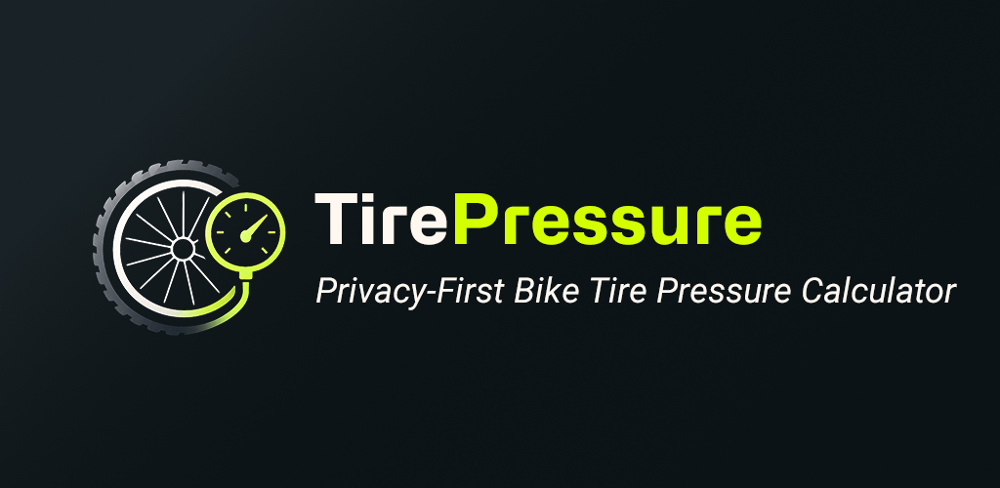
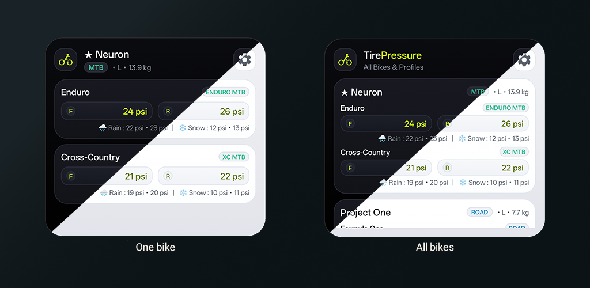

<p align="center">
  
</p>

<p align="center">
  <strong>The Ultimate Native Android Tire Pressure Companion for Road, Gravel, MTB and Commute bikes.</strong>
</p>

<p align="center">
  <a href="LICENSE"></a>
  
  
  
  
  
  
</p>

## 🤖 AI-Assisted Development

> [!NOTE]
> This application was designed, engineered, and tested with **AI-assisted coding** using Google DeepMind's **Antigravity** Advanced Agentic Coding environment. The entire development workflow—including implementation and validation of the open-source Frank Berto 15% Tire Drop physics model, Clean Architecture design, Jetpack Compose Material 3 UI/UX, native OxygenOS/ColorOS 16 & 17 style Home Screen widgets, full offline sandbox security, and 100% unit test coverage—was executed through human-AI collaborative pair programming.

## 🚴‍♂️ What TirePressure Solves: The End-User Experience

Every cyclist knows the feeling: you are gearing up for a ride, pumping your tires in the garage, and guessing what pressure to put in. 
- **Too high:** You bounce across chip-seal roads, sacrifice precious cornering grip, fatigue your upper body over gravel washboards, and risk blowing off hookless tubeless rims.
- **Too low:** You risk catastrophic rim strikes, pinch flats, tire squirm through fast berms, and sluggish rolling resistance on smooth tarmac.

**TirePressure** eliminates guesswork in seconds before you head out the door. It delivers laboratory-grade tire pressure recommendations based on **Frank Berto's renowned 15% Tire Drop physics model** combined with modern bicycle impedance and ETRTO standards, packaged in a sleek, minimalist Android app designed for effortless single-hand usage.

### 🌟 Key End-User Features & Workflow

#### 1. Zero-Friction Pre-Ride Dashboard (Overview Screen)
- **All your bikes in one glance:** No tedious menus or recalculations. Open the app and instantly see your registered bikes (Road racer, Gravel explorer, Trail MTB, etc.).
- **Live Multi-Surface Pressure Matrix (Customizable 1, 2, or 3 Conditions):** For every bike and wheelset profile, customize whether you want to calculate and display Dry, Wet, and/or Snow conditions. At minimum Dry is always calculated, and users can selectively enable 1, 2, or all 3 surfaces (e.g. Dry only for pure summer road bikes, or all 3 for winter gravel rigs):
  - ☀️ **Dry** tarmac and trails (optimal baseline speed and rolling resistance).
  - 🌧️ **Wet** roads and slippery roots (calibrated at 90% pressure for enhanced mechanical tire grip).
  - ❄️ **Snow, Sand, or Extreme Mud** (calibrated at 55% pressure for maximum tire contact patch).
- **One-Tap Unit Switching:** Toggle between **bar**, **PSI**, and **kPa** on the fly with a single tap.
- **Instant Clipboard Copy:** Tap the copy icon next to any setup to instantly copy formatted pressure specs to share with riding buddies or paste into your Strava/training notes.

#### 2. Multi-Wheelset Management, Mullet / MX & 32" Support
Modern cyclists swap wheels, ride mixed wheel sizes, or ride different disciplines with the same bike:
- **Full Mullet / MX Support (Front ≠ Rear):** Seamlessly configure bikes with mixed wheel diameters—such as **29" Front / 27.5" Rear** (the gold standard in modern Enduro, E-MTB, and DH) or **32" Front / 29" Rear** prototypes. Front and rear wheels feature completely independent diameter selectors, rim widths, tire widths, and casing structures.
- **Emerging 32" Wheel Standard (686 mm ISO):** Full compatibility with the emerging **32-inch** wheel format (`686 mm BSD`), pioneered in prototype Downhill / XC race rigs and tall-rider geometries.
- **Rich Bike Specifications & Safe Bike Management:** Record and display detailed metadata for every bike, including **Brand**, **Model**, **Year**, and **Frame Size** (in inches or letter sizing like S/M/L). When creating or editing a bike, select a primary bike category (**Road**, **Gravel**, **MTB**, or **Commute / Urban**). Bike weight and metadata can be edited anytime—changes automatically propagate to recalculate pressures across all profiles of that bike. Bikes and wheelset profiles can be safely removed with explicit warning confirmation popups to prevent accidental data loss.
- **Detailed Disciplines on Profiles:** While bikes belong to general categories, each profile / wheelset allows choosing specific riding practices (**Enduro MTB**, **Trail MTB**, **XC MTB**, **Downhill MTB**, **Road**, **Gravel**, **Cyclocross**, **Fat Bike**, **Urban**). This allows the exact same bike or wheelset to have tailored pressures depending on intended terrain and riding style.
- **Tire Width in Millimeters or Inches:** Configure tire widths in either **mm** or **inches (po / ")** with an instant toggle chip, letting you enter standard mountain bike dimensions like `2.4"` or road widths like `28mm`.
- **Profile Template Cloning:** When creating a new profile/setup for an existing bike, you can choose any existing setup as a starting template.
- **Inherited Bike Specs:** The bike's weight and configuration are automatically populated, allowing you to quickly modify just tire width, rim width, or riding discipline.
- *Real-World Scenarios Supported:*
  - **Mullet Enduro Bike:** A 29" front wheel (63.5 mm / 2.5" tire, EXO+ casing) paired with a 27.5" rear wheel (60.9 mm / 2.4" tire, DoubleDown casing).
  - **Multiple Wheelsets:** A gravel bike with a **"Summer 38mm Slicks"** wheelset and a **"Winter 45mm Knobbies"** wheelset.
  - **Discipline Variations on the Same Wheelset:** An XC mountain bike ridden for **XC Racing** (supple 0.95 factor for compliance) vs. **Trail / All-Mountain** (1.02 factor for heavier drops and berm support) vs. road training with locked suspensions.

#### 3. Android Widgets

<p align="center">
  
</p>

- **Widget 1 (Single Bike + Multi-Profile):** Displays your chosen bike with its primary and secondary wheelset setups, showing front and rear dry/wet pressures directly on your home screen. Includes a gear button to reconfigure and a bike icon to jump straight into the bike details.
- **Widget 2 (All Bikes List):** A scrollable list overview displaying all bikes in your garage, their weights, disciplines, and baseline tire pressures.
- **Personalized Theme Support:** Each widget can be configured to:
  - 🌓 **Follow System Theme** (automatically matches your OS dark/light mode)
  - ☀️ **Always Light Mode**
  - 🌙 **Always Dark Mode**
  *(Configurable individually per widget during placement or anytime via app Settings).*
- **Instant Zero-Network Live Sync:** Any modification in the app (updating rider weight, editing wheel parameters, changing units from bar to PSI, or adding bikes) automatically triggers an instantaneous update across all active home screen widgets.

#### 4. Streamlined First-Run Onboarding
- When opening TirePressure for the first time, you are guided through a gentle onboarding step to record your riding weight (in kg or lbs).
- A 3-screen interactive swipeable tutorial highlights multi-wheelset setup, live multi-surface readings, and ETRTO hookless safety warnings.
- Your rider weight acts as the central reference for your entire garage and can be updated anytime in Settings.

#### 5. Hookless Rim Safety Guard (ETRTO / ISO Standards)
- Tubeless Hookless (straight-side) rims require strict adherence to maximum pressure thresholds (max **5.0 bar / 72.5 psi** for 25–29 mm tires according to ETRTO/ISO 5775).
- If a recommended pressure exceeds safety limits due to system weight, TirePressure immediately flags the wheel with a prominent warning badge to prevent dangerous tire blow-offs.

#### 6. 100% Offline & Private by Design
- Operates completely without Internet access: works deep in alpine valleys, gravel backcountry, or basement workshops.
- The `android.permission.INTERNET` permission is **not even declared** in the Android Manifest.
- Zero analytics, zero ad SDKs, zero telemetry, no user account required.

#### 7. Frictionless JSON Backup & Restore
- Back up your entire bike collection into a clean, human-readable JSON file using Android's native Storage Access Framework (SAF).
- Restore or transfer data across devices with options to either merge or cleanly replace your database.

## 🎨 Design & Aesthetic

Inspired by modern smartphone UI innovations:
- **Electric Lime (`#D4FF00`)**: Vibrant, energetic accents highlighting primary actions, tire gauges, and key data points.
  Used as the default accent color of the app, can be changed with multiple other options.
- **Dark Titanium & Graphite (`#0E1217`, `#161B22`, `#212732`)**: High-contrast, battery-efficient dark theme tailored for outdoor sunlight readability and OLED screens.
- **Dual Typeface Typography System (Hubot Sans & Inter)**:
  - **Hubot Sans** (by GitHub, SIL OFL-1.1): Expressive, industrial geometric grotesque used for brand identity, screen headers, section titles, and high-visibility numeric pressure readings.
  - **Inter** (by Rasmus Andersson, SIL OFL-1.1): Ultra-legible, tall x-height grotesque designed for crisp readability across form fields, labels, explanatory documentation, and dense data layouts.
- **Frosted Glass Cards & Pill Gauges**: High-contrast, beautifully rounded cards and pill buttons that feel right at home on modern Android launchers.
- **Clean Material 3 Typography**: Legible typography with spacious touch targets designed for gloved fingers and quick glanceability.
- **Adaptive System Themes**: Seamless automatic switching between Dark and Light themes following your device preferences.

## 🌐 Full Bilingual Support (English & French)

TirePressure is fully bilingual:
- **Automatic System Detection:** Defaults to French if your device system language is French; otherwise defaults to English.
- **In-App Language Selector:** Change the app language anytime in the Settings screen (*System Default*, *Français*, *English*).
- **Android 13+ Per-App Language:** Integrates natively with the Android OS system settings (*App Languages*) via `locales_config.xml`.

## 📐 The Frank Berto 15% Tire Drop Open-Source Physics Engine

TirePressure builds upon **Frank Berto's renowned open-source 15% Tire Drop physics model** (originally published in *Bicycling Magazine* and *Bicycle Quarterly*), which establishes that a pneumatic bicycle tire achieves optimal rolling resistance, grip, and comfort when it deflects by roughly **15% of its cross-sectional height** under load.

Because Berto's original formula only accounts for static load and nominal tire width, **TirePressure integrates several key engineering layers** to make calculations tailored and far more accurate for modern cycling:

- **Discipline-Specific Axle Load Distribution:** Automatically splits total system mass ($\text{Rider} + \text{Bike} + \text{Luggage}$) between front and rear wheels according to riding posture—ranging from **42% / 58%** (Road) and **44% / 56%** (Gravel & Cyclocross) to **45% / 55%** (MTB) and **48% / 52%** (Fat Bike).
- **Modern Rim-to-Tire Volume Calibration (ETRTO / ISO 5775):** Computes the *effective* inflated tire width ($W_{eff}$) based on your actual inner rim width ($0.4\text{ mm}$ effective tire width change per $1\text{ mm}$ difference from discipline reference rims), fully supporting wide modern rims, mixed **Mullet / MX** setups, and **32"** wheels.
- **Dynamic Discipline Adaptation:** In a purely static formula, wider gravity tires compute lower pressures—which in real-world riding would cause rim strikes and tire squirm under 2.5–3.5G cornering and high-speed square-edge impacts. TirePressure applies calibrated dynamic multipliers across all 9 disciplines (**Road, Gravel, Cyclocross, XC, Trail, Enduro, Downhill, Fat Bike, Urban**) to balance low-pressure trail compliance against high-speed rim protection.
- **Casing, Rim Bed & Weather Modifiers:** Fine-tunes recommendations for tire casing construction (*Supple/Race, Standard, Reinforced, DoubleDown*), rim bed architecture (*Clincher Tubes, Tubular, Hooked Tubeless, Hookless, Wide Aero Hookless*), and surface grip (*Dry 100%, Wet 90%, Snow/Mud 55%*).
- **ETRTO Hookless Safety Guard:** Enforces the strict **5.0 bar (72.5 psi)** safety ceiling on hookless straight-side rims for tires $\le 29\text{ mm}$ and displays immediate visual warnings if system weight pushes pressures above safe limits.

> [!NOTE]
> **Independent Clean-Room Implementation:** TirePressure is a 100% offline, independent open-source project calibrated against empirical industry benchmarks (including reference curves from the SRAM AXS calculator). It does not use, copy, or interface with any proprietary third-party code or APIs.

## 🛠️ Tech Stack & Architecture

TirePressure is engineered with cutting-edge Android development best practices:

| Category | Technology | Badges |
| :--- | :--- | :--- |
| **Language** | Kotlin 2.1.0 + KSP 2.1.0-1.0.29 | [](https://kotlinlang.org/) |
| **UI Toolkit** | Jetpack Compose (BOM 2026.09.00) & Activity Compose 1.13.0 | [](https://developer.android.com/jetpack/compose) |
| **Lifecycle & Core** | Lifecycle Runtime Compose 2.11.0 & Core KTX 1.19.1 | [](https://developer.android.com/topic/libraries/architecture/lifecycle) |
| **Design System** | Material Design 3 | [](https://m3.material.io/) |
| **Tactile Components** | Compose Lumen (1.1.1) | [](https://github.com/angelomarzocchi/compose-lumen) |
| **AGSL Shaders** | Compose Glass (1.1.1) | [](https://github.com/angelomarzocchi/compose-glass) |
| **Hero Flights** | Compose Flight (1.1.1) | [](https://github.com/angelomarzocchi/compose-flight) |
| **Home Widgets** | Android AppWidgets & RemoteViews | [](https://developer.android.com/guide/topics/appwidgets) |
| **Architecture** | MVVM + Clean Architecture | [](https://developer.android.com/topic/architecture) |
| **Persistence** | Room Database 2.8.5 + KSP | [](https://developer.android.com/training/data-storage/room) |
| **Preferences** | Jetpack DataStore Preferences 1.2.1 | [](https://developer.android.com/topic/libraries/architecture/datastore) |
| **Concurrency** | Kotlin Coroutines & Flow 1.10.1 | [](https://github.com/Kotlin/kotlinx.coroutines) |
| **Serialization** | Kotlinx Serialization JSON 1.8.1 | [](https://github.com/Kotlin/kotlinx.serialization) |
| **Navigation** | Jetpack Navigation 3 (1.2.0) | [](https://developer.android.com/guide/navigation/navigation-3) |
| **Adaptive & Foldables** | Material 3 Adaptive 1.3.0 (Layout & Window Metrics) | [](https://developer.android.com/jetpack/androidx/releases/compose-material3-adaptive) |
| **Testing** | JUnit 4, Coroutines Test, Compose UI Test | [](https://junit.org/) |
| **Build System** | Gradle 8.10.2 + AGP 8.7.2 | [](https://gradle.org/) |
| **Target Platform** | Android 16 (API 36) / Min: API 26 | [-3DDC84?style=flat-square&logo=android&logoColor=white)](https://developer.android.com/about/versions/16) |

### Project Directory Layout

```
app/src/main/java/com/tirepressure/app/
├── core/
│   ├── model/          # Units (Bar, PSI, kPa, kg, lb), Themes, AppLanguage, WidgetTheme
│   └── util/           # Unit conversions & math helpers
├── domain/
│   ├── model/          # Domain models (BikeProfile, WheelSetup, TireConfig, WheelConfig...)
│   ├── calculator/     # Frank Berto 15% tire drop calculation engine implementation & validator
│   └── repository/     # Repository contracts (BikeRepository, PreferencesRepository)
├── data/
│   ├── local/          # Room DB (AppDatabase, BikeDao, BikeEntity with serialized setups)
│   ├── repository/     # Concrete repositories (BikeRepositoryImpl, PreferencesRepositoryImpl)
│   └── backup/         # BackupManager (JSON export/import SAF pipeline & validation)
├── widget/
│   ├── SingleBikeWidgetReceiver.kt     # AppWidgetProvider for single bike + profiles
│   ├── AllBikesWidgetReceiver.kt       # AppWidgetProvider for scrollable list of all bikes
│   ├── AllBikesWidgetService.kt        # RemoteViewsService & RemoteViewsFactory
│   ├── SingleBikeWidgetConfigureActivity.kt # Configuration UI (bike & theme selection)
│   ├── AllBikesWidgetConfigureActivity.kt    # Configuration UI (theme selection)
│   ├── WidgetPreferencesHelper.kt     # Per-widget and default theme/bike storage
│   └── WidgetUpdateHelper.kt          # Automatic broadcast & dataset refresh helper
└── ui/
    ├── theme/          # Material 3 palette (Electric Lime, Titanium, Dark/Light modes)
    ├── components/     # Reusable components (SectionCard, NumberInputField, PillSelector...)
    ├── navigation/     # AppNavigation, Navigation 3 & Material 3 Adaptive ListDetailPaneScaffold
    ├── onboarding/     # First-run weight prompt & swipeable tutorial (HorizontalPager)
    ├── overview/       # Main dashboard: bikes with multi-setup & multi-surface pressures
    ├── bikes/          # Bike & wheelset setup editor (calculator-style inputs with inch tags)
    ├── info/           # AppInfoScreen (version, credits, GitHub repository & privacy overview)
    └── settings/       # Settings (rider weight, language, units, themes, widgets, JSON backup/restore)
```

## 🔨 Building & Testing

### Prerequisites
- **JDK 21** (Eclipse Adoptium Temurin 21 or OpenJDK 21 LTS)
- **Android SDK Platform 36** with **Build-Tools 36.0.0**

### Environment Setup (PowerShell)
```powershell
$env:JAVA_HOME = "C:\Program Files\Eclipse Adoptium\jdk-21.0.12.101-hotspot"
$env:ANDROID_HOME = "C:\Android"
```

### Running Unit Tests
Execute the automated test suite verifying Berto 15% drop mathematical accuracy, Hookless safety rules, widget preferences, unit conversions, and JSON import/export:
```powershell
.\gradlew.bat testDebugUnitTest
```

### 📲 Ready-to-Test Release Artifacts
The official pre-compiled release artifacts built with full R8 optimization, resource shrinking, and baseline profiles are provided directly in the repository for immediate installation and testing:
- **Direct APK:** [`files/TirePressure.apk`](files/TirePressure.apk)
- **Play Store Bundle (AAB):** [`files/TirePressure.aab`](files/TirePressure.aab)
- **Native Debug Symbols:** [`files/native-debug-symbols.zip`](files/native-debug-symbols.zip)

Install directly onto a connected device via ADB:
```powershell
adb install -r files/TirePressure.apk
```

### Building the Debug APK
Compile and package the debug APK:
```powershell
.\gradlew.bat assembleDebug
```
The output APK is located at:
```
app/build/outputs/apk/debug/app-debug.apk
```

Install directly onto a connected device via ADB:
```powershell
adb install -r app/build/outputs/apk/debug/app-debug.apk
```

## 📄 License & Third-Party Notices

This project's source code is open-source software licensed under the **[MIT License](LICENSE)**.

```
MIT License

Copyright (c) 2026 TirePressure Contributors
```

### Third-Party Typefaces & Assets
The bundled typefaces are distributed under their own upstream open-source licenses and are **not** covered by the project's MIT License:
- **Hubot Sans:** Copyright (c) 2022, GitHub Inc. ([SIL Open Font License 1.1](third_party/fonts/hubot-sans/LICENSE))
- **Inter:** Copyright (c) 2016-2024, The Inter Project Authors ([SIL Open Font License 1.1](third_party/fonts/inter/LICENSE.txt))

For full licensing terms, upstream repository references, and complete verbatim OFL-1.1 text, see **[THIRD_PARTY_NOTICES.md](THIRD_PARTY_NOTICES.md)**.
